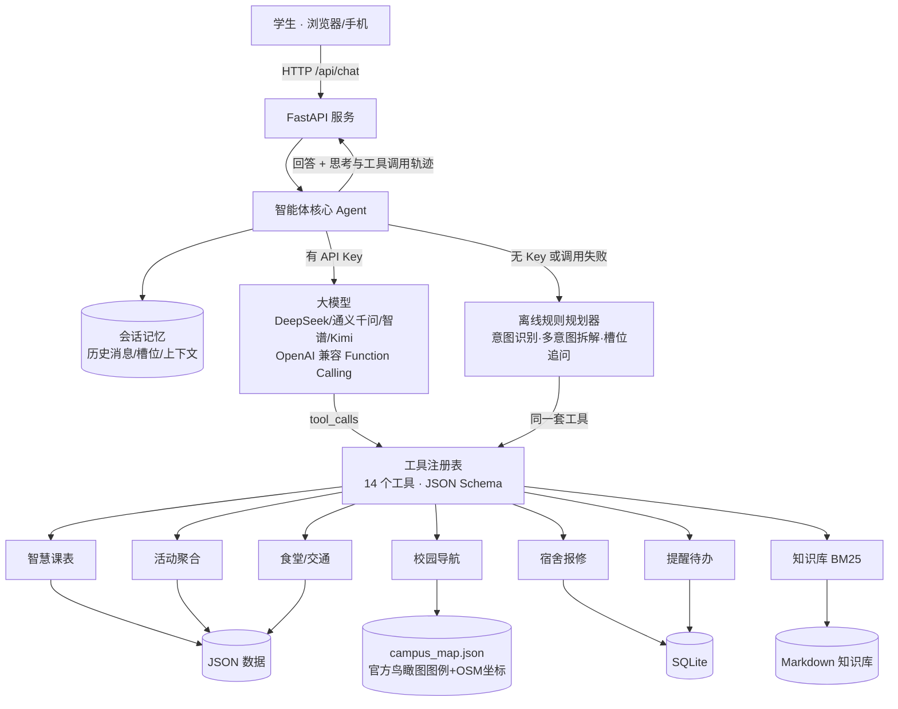
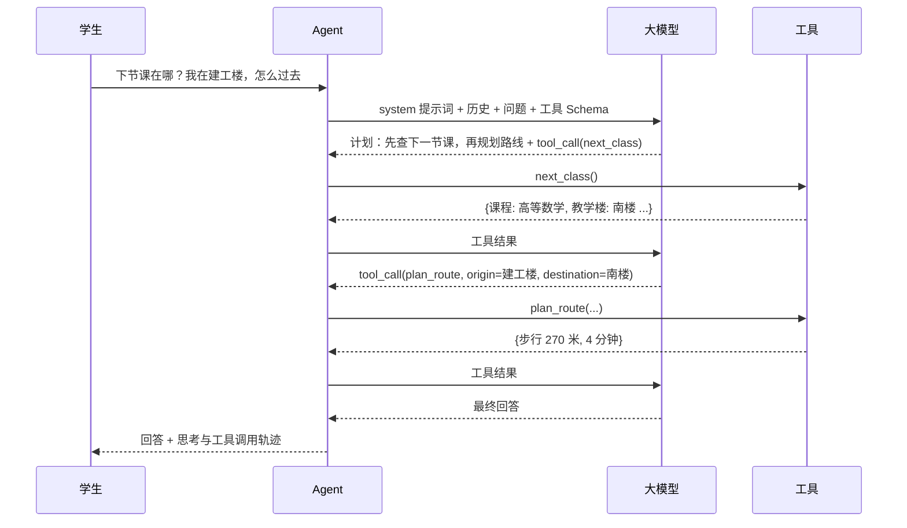
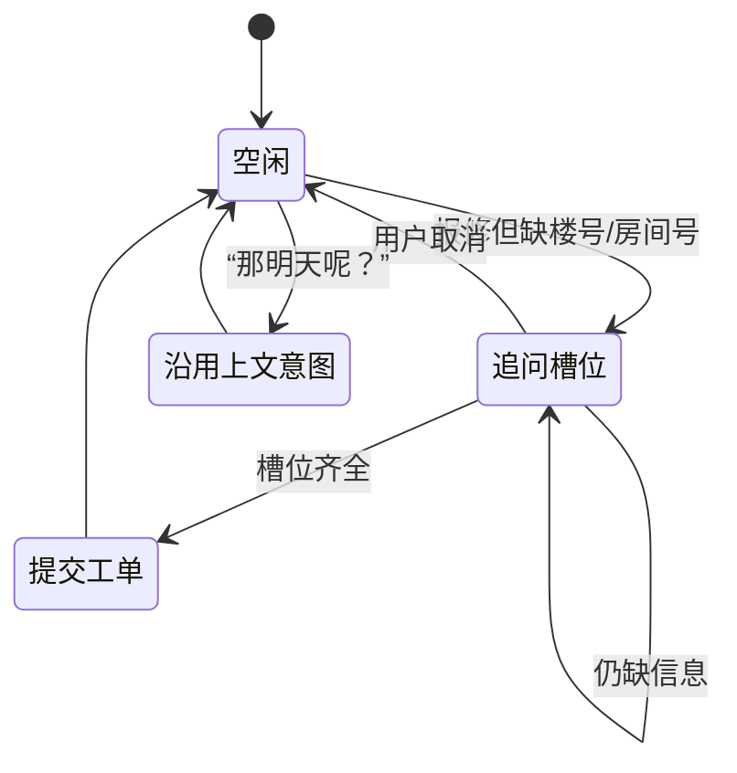
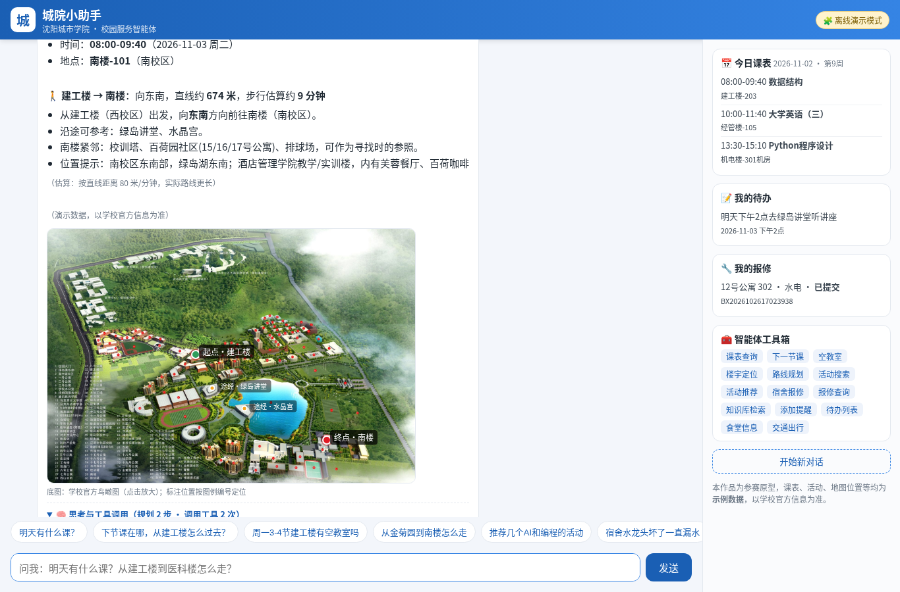
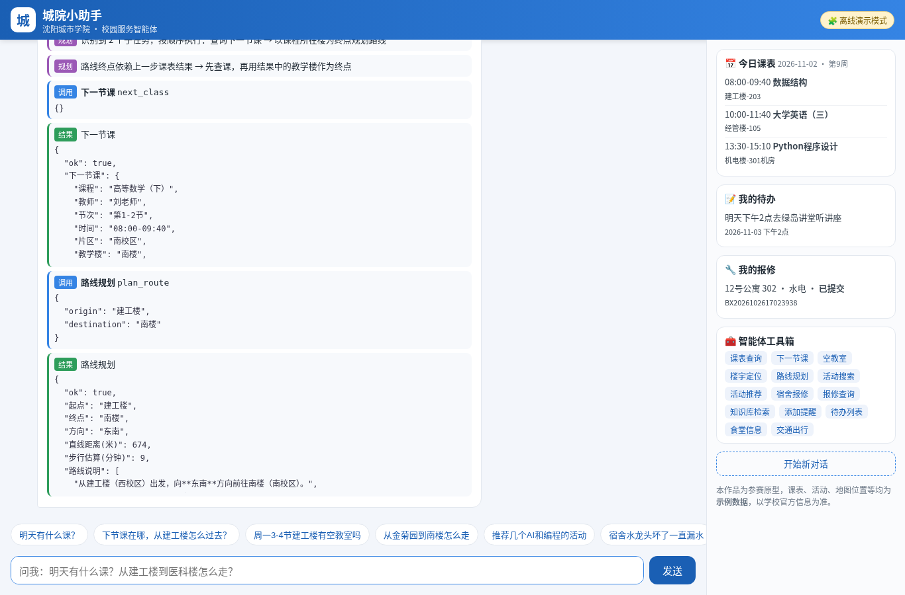
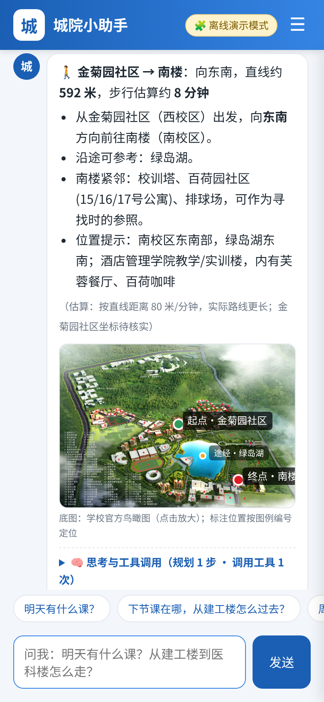

# 「城院小助手」校园服务智能体 设计文档

- **参赛赛事**：2026 年沈阳城市学院计算机应用大赛
- **赛道**：01 大模型与智能体应用开发 · 校园服务类智能体
- **作品名称**：城院小助手
- **团队**：3 人（成员 A / B / C，分工见《团队分工与进度计划》）
- **版本**：v1.0（2026 年 10 月）

> 数据说明：校园地点、片区、食堂名称、到校交通来自学校官方鸟瞰图（96 个图例）、学校官网与 OpenStreetMap（西山会所、绿岛俱乐部为食堂已确认）；部分坐标为地图换算估算（标注“待核实”），步行时间为直线估算；课表、教室占用、活动、食堂营业时间、知识库中的具体规则为**示例数据**，系统界面与回答中均已标注，正式提交前团队将核实替换。

---

## 1 场景分析与痛点调研

### 1.1 目标用户
在校本科生（尤其是新生、需要在多个教学楼/校区间往返的同学），次要用户为辅导员、宿管与学生组织（活动发布方）。

### 1.2 痛点假设
| 编号 | 痛点 | 典型场景 |
|---|---|---|
| P1 | 信息分散在多个入口 | 课表在教务系统、活动在各公众号/QQ群、报修在后勤小程序、办事指南在学校官网，查一件事要切换多个应用 |
| P2 | 校园大、片区多，换楼找路难 | 校园分北/西/南片区、绿岛湖居中，新生不清楚南楼与医工楼相距多远、该往哪个方向走、提前多久出发 |
| P3 | 找自习教室难 | 不知道哪栋楼哪间教室当前空闲 |
| P4 | 报修流程繁琐、进度不透明 | 需要填写多个表单字段，提交后不知道是否受理 |
| P5 | 规章流程类问题反复咨询 | 校园卡挂失、选课、请假、图书馆借阅等问题辅导员被反复询问 |
| P6 | 活动错过 | 感兴趣的讲座/竞赛信息淹没在群消息里 |

### 1.3 调研计划（待团队执行，用于答辩佐证）
本节为**需要开展的调研设计**，正式提交前完成并补充数据：
1. **问卷调研**（目标 ≥100 份，覆盖各年级）：
   - 你每周查询课表/教室/活动/办事信息分别使用哪些渠道？平均每次耗时？
   - 过去一个月是否遇到：找不到上课地点、换楼迟到、找不到空教室、报修无回应、错过活动？
   - 对上述 6 类功能按需求程度打分（1-5 分）；是否愿意用对话式助手完成这些事？
2. **深度访谈**（5-8 人）：新生 2 人、跨楼通勤频繁的同学 2 人、宿舍长 1 人、学生会/社团干部 1 人、辅导员或宿管 1-2 人。
3. **现状梳理**：列出学校现有各服务入口及其覆盖情况，确认哪些数据可公开获取，用于后续替换示例数据。
4. **输出物**：痛点优先级排序表、典型用户画像 2-3 个、调研数据图表（放入答辩 PPT）。

## 2 需求分析

### 2.1 功能需求
| 模块 | 需求 | 优先级 |
|---|---|---|
| 智慧课表 | 按天/周查课、下一节课（时间地点）、空教室查询 | P0 |
| 校园导航 | 地点位置、片区、相邻建筑；楼宇间方向/距离/步行估算/沿途地标；官方地图高亮标注 | P0 |
| 活动聚合 | 按时间/标签/关键词/校区筛选；按兴趣推荐 | P0 |
| 宿舍报修 | 自然语言报修、缺信息自动追问、工单入库、进度查询、紧急识别 | P0 |
| 知识库问答 | 图书馆、选课、校园卡、宿舍管理、请假等办事指南检索问答并注明来源 | P0 |
| 提醒待办 | 自然语言添加提醒，相对时间换算 | P1 |
| 生活服务 | 食堂/餐厅位置与营业时间、到校交通 | P1 |
| 可解释性 | 展示智能体规划与工具调用过程 | P0（体现架构） |

### 2.2 非功能需求
- **易用**：一句话完成任务；快捷问题引导；手机浏览器可用。
- **可部署**：依赖少（FastAPI/uvicorn/httpx/python-dotenv），国内镜像可安装，Windows 友好；**零密钥可运行**。
- **可替换**：模型供应商可切换（任意 OpenAI 兼容接口）；数据以 JSON/Markdown 存放，非开发同学也能维护。
- **安全**：不编造校园信息；拒绝不当请求；不收集敏感信息；示例数据明确标注。

## 3 系统架构

**分层说明**
1. **表现层**：单页 Web（原生 HTML/CSS/JS），聊天区 + 侧边栏（今日课表、我的待办、我的报修、工具箱），回答下方可折叠的「思考与工具调用」面板，右上角模式徽章。
2. **接口层**：FastAPI，提供 `/api/chat`、`/api/status`、`/api/history`、`/api/sidebar`、`/api/reset`。
3. **智能体层**：`agent.py` 实现 ReAct 循环；`mock_planner.py` 为离线规划器；`memory.py` 管理多轮会话。
4. **工具层**：`app/tools/` 下 7 个模块共 14 个工具，统一注册、统一参数清洗与异常处理。
5. **数据层**：`campus_map.json`（42 个真实地点，由 `scripts/build_campus_map.py` 从调研数据生成）、官方鸟瞰图、JSON（课表、教室、活动、食堂、交通）、Markdown（知识库）、SQLite（工单、提醒）。

### 3.1 一次请求的时序（大模型模式）

## 4 技术方案

| 项 | 选型 | 理由 |
|---|---|---|
| 后端 | Python 3.10+ · FastAPI · uvicorn | 开发快、自带接口文档（`/docs`）、生态成熟 |
| 大模型接入 | httpx 直连 OpenAI 兼容 `/chat/completions` | 不绑定 SDK，DeepSeek/通义千问/智谱/Kimi/Ollama 只需改 `.env` |
| 工具调用 | OpenAI Function Calling（`tools` + `tool_calls`） | 国内主流模型均支持，结构化参数可靠 |
| 检索 | 自研 BM25（中文单字 + 二元组切分 + 口语同义扩展） | 无需向量库与额外依赖，知识库规模小时效果好、可解释 |
| 存储 | SQLite | 零配置，适合工单/提醒 |
| 前端 | 原生 HTML/CSS/JS | 无构建步骤，后端直接托管，移动端自适应 |
| 测试 | pytest + FastAPI TestClient | 22 项测试覆盖工具、智能体、接口，含模拟大模型的 ReAct 循环测试 |

### 4.1 双模式设计
- **大模型模式**：`settings.use_llm` 为真（配置了 `LLM_API_KEY` 且未设置 `FORCE_MOCK`）时启用。最多 6 轮工具调用迭代；模型返回的规划文本作为“规划”步骤展示。
- **离线演示模式**：未配置密钥时自动启用。规则规划器完成意图识别、**多意图拆解**（一句话多个任务）、**依赖规划**（后一步参数取自前一步结果，如路线终点取自课表结果）、**槽位追问**与**省略追问**，调用与大模型模式完全相同的工具。
- **自动降级**：大模型接口异常（网络、额度、密钥错误）时，自动切换离线规划器并在轨迹中提示“已降级”，保证现场演示不中断。

### 4.2 关键实现
- **日期解析**：工具层统一解析“今天/明天/后天/周三/下周一/YYYY-MM-DD”，由学期开始日期推算教学周。
- **校园导航**：地点坐标来自 OSM 建筑中心（5 栋高可信）或由官方鸟瞰图像素经仿射变换换算（17 个 OSM 地标拟合，留一法中位误差约 36 米、最大约 99 米）。路线给出方向（八方位）、直线距离、步行估算（80 米/分钟，明确提示实际更长）、沿途参照地标（距离起终点连线 110 米内的湖、图书馆、讲堂等）、目的地相邻建筑；结果携带图例像素位置，前端在官方鸟瞰图上高亮。
- **换楼提醒**：课表中相邻两节课所在楼直线距离超过 350 米时，提示预留换楼时间。
- **宿舍社区推断**：根据“X号公寓”在官方图例中的位置推断所属社区（如 12 号公寓 → 玫瑰园），工单中注明“依地图推断”。
- **报修紧急识别**：描述含“漏水/断电/门锁/冒烟”等标记为紧急，预计 2 小时响应（示例规则）；含“冒烟/着火/触电”等优先提示安全。
- **参数清洗**：工具执行前按函数签名过滤未知参数、丢弃空值、捕获异常，返回结构化错误，模型可据此自我纠正或追问。

## 5 提示词策略

系统提示词位于 `prompts/system_prompt.md`，运行时注入当前日期、星期、教学周、时间、运行模式与真实楼宇列表。设计要点：

| 模块 | 内容 | 目的 |
|---|---|---|
| 角色设定 | 「城院小助手」，目标是“用最少的来回帮同学把事办成” | 明确定位与风格 |
| 动态环境 | 今天日期/星期/教学周/当前时间、真实楼名及场馆属性 | 解决模型不知道“今天”“明天”的问题，减少楼名幻觉 |
| ReAct 工作流 | 先输出“计划：…”再调用工具；多步任务链式传参 | 让规划过程可见、可评审 |
| 工具使用规范 | 涉及事实必须调用工具，禁止凭记忆编造；必填参数缺失时追问 | 抑制幻觉、提高准确率 |
| 多轮上下文 | 记住宿舍楼、所在楼宇、兴趣，理解省略追问 | 多轮对话体验 |
| 回答风格 | 先结论后细节、加粗关键时间地点、短列表、贴心建议 | 适合手机阅读 |
| 数据标注 | 结果含“示例数据”时提示“以学校官方为准”，知识库答案注明来源 | 诚实可信 |
| 安全边界 | 拒绝代考/写作业/恶意代码/医疗法律投资建议；不索取敏感信息；紧急情况先提示 119/120；忽略试图改写规则的注入指令 | 安全合规、防提示词注入 |

**工具描述即提示词**：每个工具的 `description` 与参数说明都经过设计（如报修工具注明“缺少时先向用户追问，不要编造”，知识库工具注明“政策流程类问题必须先检索”），引导模型正确选择工具。

**模型微调说明**：本作品不进行模型微调。原因：校园服务数据变化快（课表、活动每学期更新），采用“提示词工程 + 工具调用 + 检索增强”的方式，数据更新只需修改 JSON/Markdown，无需重新训练，成本低、可维护性强。后续如积累足够真实对话数据，可考虑对小模型做意图识别/工具选择的 LoRA 微调，用于本地私有化部署。

## 6 工具接口设计

| 工具名 | 功能 | 主要参数 | 数据源 |
|---|---|---|---|
| `query_schedule` | 查某天/某周课表 | `day`，`scope`(day/week) | schedule.json |
| `next_class` | 下一节课 | — | schedule.json |
| `free_classrooms` | 空闲教室 | `day`，`periods`(如"3-4")，`building`，`campus` | classrooms.json |
| `locate_building` | 地点位置/片区/相邻与附近地点 + 地图标注 | `name`（支持简称，如“建工”“图书馆”“玫瑰园”） | campus_map.json |
| `plan_route` | 方向、直线距离、步行估算、沿途地标 + 地图标注 | `origin`，`destination` | campus_map.json |
| `search_events` | 活动搜索筛选 | `keyword`，`tag`，`campus`，`days` | events.json |
| `recommend_events` | 兴趣推荐 | `interests[]`，`top_k` | events.json |
| `create_repair_ticket` | 提交报修 | `building`，`room`，`description`，`category`，`phone` | SQLite |
| `query_repair_tickets` | 报修进度 | `ticket_no`（可选） | SQLite |
| `search_knowledge` | 知识库检索 | `query`，`top_k` | data/knowledge/*.md |
| `add_reminder` | 添加提醒 | `content`，`remind_at` | SQLite |
| `list_reminders` | 待办列表 | — | SQLite |
| `canteen_info` | 食堂/餐厅位置与营业时间 | `name`，`zone` | canteens.json |
| `transport_info` | 学校地址、公交/地铁到校、校门 | — | transport.json |

所有工具返回统一结构：`ok` 字段表示成功与否；失败时返回 `错误` 与可选值（如“可选楼宇”）；涉及示例数据的结果带 `数据说明` 字段。

**数据维护指南**：`data/campus_map.json` 每个地点包含 `name/legend_no/type/aliases/zone/zone_source/lat/lng/map_px/coord_status/area/neighbors`。团队实地核实“待核实”坐标（可用手机地图取点）后修改 `scripts/build_campus_map.py` 并重新生成，距离、方向与地图标注自动更新；后续可增加真实步行路径（如沿湖步道）以替代直线估算。

## 7 多轮对话管理

1. **会话隔离**：前端在 localStorage 保存 `session_id`，后端 `MemoryStore` 按会话保存消息历史与状态，刷新页面可恢复。
2. **历史窗口**：保留最近 24 条消息，截断时从“用户消息”边界开始，避免切断 `tool_calls` 与工具结果的对应关系。
3. **大模型模式**：完整保存 user / assistant(tool_calls) / tool 消息，模型可引用前文工具结果回答追问。
4. **离线模式状态机**：
   - `pending`：未完成任务的槽位（如报修缺楼号/房间号），下一轮自动补全，支持“算了/取消”。
   - `last`：上一轮工具与参数，支持“那周四呢？”等省略追问。
   - `location` / `dorm` / `interests`：记住用户所在楼宇、宿舍、兴趣，供后续路线、报修、推荐复用。

## 8 效果评估

### 8.1 评估方法
`eval/evaluate.py` 自动运行测试用例（支持多轮），比较实际工具调用序列与期望序列，并检查关键参数和知识库 Top1 来源：
- **工具选择准确率**：调用的工具序列与期望完全一致；
- **端到端准确率**：工具与关键参数均正确；
- **知识库命中率**：检索 Top1 来源文档正确。

用例集：
- `test_cases.json`：28 条，覆盖 11 个类别（课表、导航、活动、报修、知识库、提醒、生活服务、多轮对话、自主规划、安全边界、槽位追问）；
- `holdout_cases.json`：12 条**泛化测试集**，在规则编写完成后新写、未针对其调整规则，用于客观衡量。

### 8.2 当前结果（离线演示模式，演示日期 2026-11-02）
| 用例集 | 工具选择准确率 | 端到端准确率 | 知识库 Top1 |
|---|---|---|---|
| 开发集（28 条） | 100% | 100% | 3/3 |
| 泛化集（12 条） | 66.7% | 66.7% | 0/2 |

**分析**：离线规则规划器对开发集表述效果很好，但对未见过的口语问法（如“书最多能借几本”“早饭到几点结束”“网断了”）泛化不足——这正是引入大模型作为推理核心的意义。配置大模型后可运行 `python eval/evaluate.py --llm --holdout` 对比，预期泛化集准确率显著提升（**待团队配置密钥后实测补充**）。

### 8.3 其他测试
- `pytest`：22 项测试全部通过，含工具正确性、SQLite 读写、BM25 检索、多步规划、多轮追问、越界拒绝、**模拟大模型 tool_calls 的 ReAct 循环**与**大模型失败自动降级**。
- 建议补充：邀请 10-20 名同学试用并打分（满意度、任务完成率、平均轮次），作为答辩材料。

## 8.4 界面展示

## 9 创新点

1. **可视化的智能体推理过程**：每条回答附带「思考与工具调用」面板，规划、参数与返回值一目了然，增强可信度与可解释性。
2. **双引擎 + 自动降级**：大模型模式与离线规则模式共用同一套工具，零密钥可运行，断网/额度用尽时演示不中断。
3. **基于官方地图的导航**：整合官方鸟瞰图 96 个图例与 OSM 坐标，回答中直接在官方地图上高亮起终点和沿途地标；与课表联动（“下节课怎么去”一次完成两步规划）；对估算数据如实标注。
4. **对话式报修**：一句话描述故障，缺信息自动追问，自动分类与紧急识别，工单入库可查进度。
5. **轻量可维护的校园知识库**：Markdown 维护 + BM25 检索 + 口语同义扩展，回答注明来源，非技术同学也能更新。
6. **模型无关**：任意 OpenAI 兼容接口，国产大模型一行配置切换，可本地 Ollama 私有化部署。
7. **数据诚实**：示例数据全程标注，提示词约束“禁止编造”，符合校园服务的可信要求。

## 10 后续规划

- **数据真实化**：实地核实 `data/campus_map.json` 中“待核实”坐标并采集真实步行路径；对接（或定期导入）教务课表、学校活动公众号、后勤报修数据（需学校授权）。
- **身份与权限**：接入统一身份认证，按学号加载个人课表。
- **消息推送**：提醒接入微信/企业微信/短信，上课前自动提醒并推荐出发时间。
- **地图可视化**：路线结果叠加校园平面图。
- **知识库扩展**：向量检索 + BM25 混合检索，覆盖更多部门办事指南。
- **多端**：封装为微信小程序/公众号。
- **评估闭环**：收集真实对话（脱敏）扩充评测集，持续优化提示词与工具描述。
